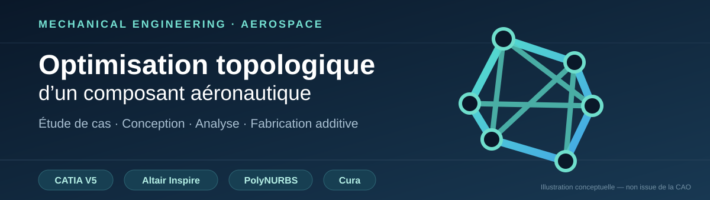
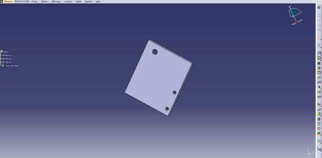
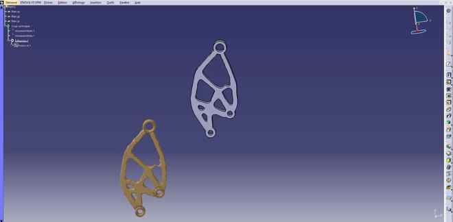
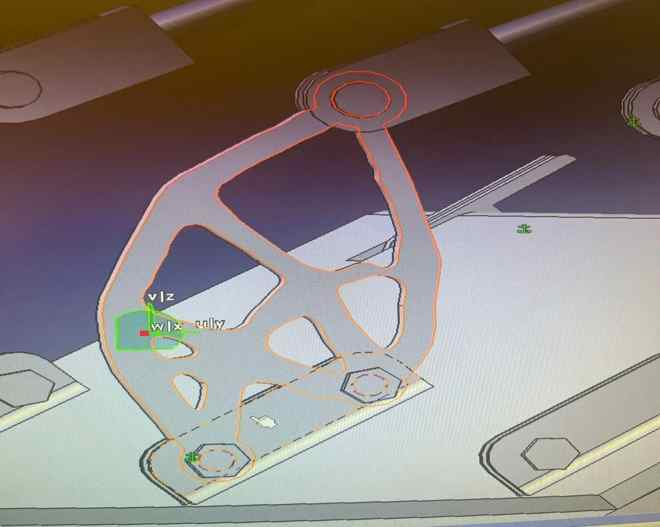
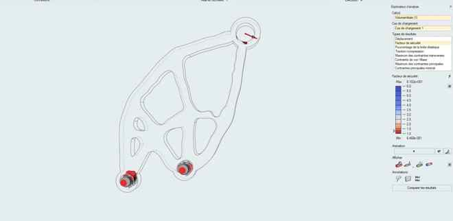
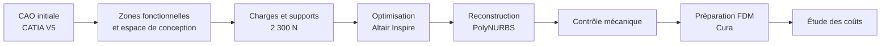

<div align="center">



# Optimisation topologique d’un composant aéronautique

**Reconception mécanique · Analyse structurale · Fabrication additive · Étude technico-économique**

[](https://elmokhtarrayadi21-creator.github.io/optimisation-topologique-aeronautique/)
[](https://github.com/elmokhtarrayadi21-creator)

CATIA V5 · Altair Inspire · PolyNURBS · Ultimaker Cura

</div>

---

## Résumé du projet

Ce projet porte sur la **reconception d'un composant mécanique associé aux portes du train d'atterrissage**, avec pour objectif d'étudier une réduction de masse tout en conservant les zones de fixation et en vérifiant son comportement sous charge. Une géométrie initiale a été modélisée dans **CATIA V5**, puis une optimisation topologique a été menée dans **Altair Inspire**. La forme allégée a été reconstruite à l'aide de **PolyNURBS** et des paramètres de fabrication additive ont été comparés dans **Ultimaker Cura** (12 configurations). Une évaluation technico-économique complète l'étude.

**Résultats à retenir :** masse initiale de **55 g** et masse retenue après reconception de **24 g** (allègement théorique d'environ **56,4 %**) ; chargement étudié de **2 300 N**. **Limite déterminante :** le facteur de sécurité minimal montré par le calcul (**≈ 0,647**) est inférieur à l'objectif (**1,25**). Le résultat constitue donc une **piste d'allègement à fiabiliser**, et non une pièce mécaniquement validée.

## Démarche en 30 secondes

**Problématique.** Comment alléger un composant transmettant l’effort des vérins pneumatiques aux portes du train d’atterrissage, sans perdre ses interfaces fonctionnelles et en tenant compte de la fabrication additive ?

**Démarche.** Modélisation du volume initial, définition des surfaces protégées et des cas de charge, optimisation de la distribution de matière, reconstruction de la géométrie, contrôle mécanique puis estimation des coûts.

**Livrable numérique.** Une [**application interactive accessible ici**](https://elmokhtarrayadi21-creator.github.io/optimisation-topologique-aeronautique/) qui permet de découvrir les étapes, les résultats, les essais Cura et un comparateur économique.

### Chiffres clés de l'étude

| Indicateur | Valeur |
| :-- | --: |
| Charge maximale étudiée | **2 300 N** |
| Coefficient de sécurité **visé** | **1,25** |
| Épaisseur minimale imposée | **7 mm** |
| Masse de la pièce initiale | **55 g** |
| Masse de la nouvelle pièce (valeur retenue dans l’étude économique) | **24 g** |
| Allègement calculé à partir de ces masses | **56,4 %** |

> **À lire avec prudence :** ces valeurs sont issues des documents de projet. La masse retenue dans le calcul économique diffère de certaines masses du plan d’expérience Cura. La satisfaction du critère de sécurité n’est pas démontrée ici par un fichier de résultats vérifiable.

## Images réelles du projet

Les captures ci-dessous proviennent du travail de conception et de simulation. Il s'agit de **captures CATIA V5 et Altair Inspire**, et non d'illustrations générées pour le portfolio.

### 1. Géométrie initiale — CATIA V5

Modèle de départ avec ses trois zones de fixation, avant définition de l'espace de conception et recherche d'allègement.

<p align="center"></p>

### 2. Reconstruction de la pièce optimisée — CATIA V5

La capture présente deux représentations d'une géométrie allégée : une forme reconstruite en CAO et une autre géométrie de comparaison. Elle permet de visualiser la répartition de matière obtenue.

<p align="center"></p>

### 3. Intégration de la pièce dans son mécanisme

Positionnement de la pièce et visualisation des interfaces mécaniques dans l'environnement d'assemblage.

<p align="center"></p>

### 4. Résultat mécanique — Altair Inspire

Vue du **facteur de sécurité** pour le cas de chargement étudié.

<p align="center"></p>

> **Vérification indispensable :** la capture indique un facteur de sécurité minimal d'environ **0,647**, alors que la cible de l'étude est **1,25**. Cette image ne permet donc **pas d'affirmer la validation mécanique complète**. Il faut examiner la zone critique, les conditions aux limites et, si nécessaire, modifier la conception puis relancer le calcul.

## Démarche technique



| Phase | Travail présenté |
| :-- | :-- |
| **Conception** | Enveloppe géométrique, encombrement et prise en compte des deux vis et de la goupille |
| **Préparation mécanique** | Définition des volumes protégés, des supports, du matériau CPE CFF et de la force appliquée |
| **Optimisation** | Recherche d’une géométrie allégée sous contraintes |
| **Reconstruction** | Lissage de la forme obtenue avec PolyNURBS |
| **Vérification** | Nouvelle analyse mécanique à réaliser sur la forme reconstruite |
| **Fabrication** | Orientation, hauteur de couche et vitesse d’impression étudiées avec Cura |
| **Économie** | Comparaison entre pièce usinée et solution additive |

## Étude de fabrication additive

Les essais Cura présentés dans le rapport font varier **deux orientations (A/B)**, les **hauteurs de couche 0,10 / 0,15 / 0,20 mm** et les **vitesses 40 / 80 mm/s**. La démo permet de consulter les 12 configurations du plan d’expérience.

## Comparaison économique — valeurs déclarées dans le rapport

| Poste | Pièce initiale | Nouvelle pièce |
| :-- | --: | --: |
| Fabrication | 40 € | 156 € |
| Matière | 40 € | 2,272 € |
| Coût carburant théorique | 385 € | 168 € |
| **Total indiqué dans le rapport** | **425 €** | **326,272 €** |

**Point de contrôle :** le total indiqué pour la pièce initiale ne correspond pas à l’addition des trois postes (**40 + 40 + 385 = 465 €**). Il est donc nécessaire de clarifier la base de calcul avant toute conclusion définitive sur le gain économique. L’hypothèse de coût carburant est celle retenue dans l'étude, et non une économie mesurée en service.

## Explorer la démonstration

[**→ Ouvrir l’interface interactive**](https://elmokhtarrayadi21-creator.github.io/optimisation-topologique-aeronautique/)

L’interface comprend notamment :
- un aperçu du composant et de la démarche d’optimisation ;
- des captures tirées des rapports de conception/simulation ;
- un **visualiseur STL** permettant d’importer un modèle local (le fichier natif n’est pas disponible dans ce dépôt) ;
- la comparaison des **12 scénarios Cura** ;
- un **calculateur économique paramétrable** ;
- des notes de vérification sur la cohérence des données.

## Organisation du dépôt

```text
optimisation-topologique-aeronautique/
├── index.html          # Application interactive autonome
├── assets/
│   └── banner.svg      # Bannière conceptuelle du projet
└── README.md           # Documentation technique et accès à la démo
```

## Compétences illustrées

**Conception mécanique** · **CAO CATIA V5** · **Optimisation topologique** · **Interprétation d'analyses mécaniques** · **Fabrication additive** · **Étude technico-économique** · **Valorisation web interactive**

## Périmètre du projet

Projet académique **réalisé en groupe**. Les noms des membres ne sont pas affichés. Les rapports n’ont pas été publiés intégralement dans le dépôt ; les illustrations issues du travail collectif doivent être diffusées avec les autorisations appropriées. Le code web présente les analyses et ne remplace ni une simulation éléments finis ni une validation industrielle. **Aucun fichier CATPart/STL réel n’a été fourni.**

---

<div align="center">

### Découvrir le projet

[**Application interactive**](https://elmokhtarrayadi21-creator.github.io/optimisation-topologique-aeronautique/) · [**Tous mes projets d’ingénierie**](https://github.com/elmokhtarrayadi21-creator)

</div>
