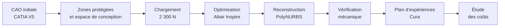

<div align="center">


# Optimisation topologique d’une pièce aéronautique

**Reconception allégée · Fabrication additive · Étude technico-économique**

[](https://elmokhtarrayadi.github.io/optimisation-topologique-aeronautique/)
[](https://github.com/elmokhtarrayadi)

CATIA V5 · Altair Inspire · PolyNURBS · Ultimaker Cura

</div>

## Le problème

En aéronautique, chaque gramme coûte du carburant. La pièce étudiée transmet l’effort des **vérins pneumatiques aux portes du train d’atterrissage**. Objectif : **réduire sa masse** sans toucher à ses interfaces (deux vis, une goupille) et en la rendant **fabricable en impression 3D**.

## Résultats clés

| Indicateur | Valeur |
| :-- | --: |
| Masse initiale → optimisée | **55 g → 24 g** |
| Allègement | **−56 %** |
| Charge de dimensionnement | **2 300 N** |
| Configurations d’impression comparées | **12** |
| Coût total estimé (fabrication + matière + carburant) | **465 € → 326 €** (≈ −30 %) |

## Démarche



### 1. Géométrie initiale — CATIA V5
Modèle de départ avec ses trois zones de fixation, épaisseur minimale imposée de 7 mm.

<p align="center"></p>

### 2. Optimisation et reconstruction
Définition des volumes protégés, des appuis, du matériau (CPE CFF) et de l’effort, puis optimisation de la répartition de matière sous Altair Inspire. La forme obtenue est lissée avec **PolyNURBS** et reprise sous CATIA V5.

<p align="center"></p>

<p align="center"></p>

### 3. Vérification mécanique — Altair Inspire
Le calcul de la forme reconstruite fait apparaître un **facteur de sécurité minimal de 0,65**, localisé, pour une cible de **1,25**. Cette vérification fait partie de la démarche : elle montre que la première itération est trop agressive et indique **où remettre de la matière** (voir « Prochaine itération »).

<p align="center"></p>

### 4. Fabrication additive — plan d’expériences Cura
Deux orientations × trois hauteurs de couche (0,10 / 0,15 / 0,20 mm) × deux vitesses (40 / 80 mm/s), soit **12 configurations** comparées en temps d’impression et en matière.

### 5. Étude technico-économique

| Poste | Pièce initiale (usinée) | Pièce optimisée (FA) |
| :-- | --: | --: |
| Fabrication | 40 € | 156 € |
| Matière | 40 € | 2,27 € |
| Carburant (coût théorique) | 385 € | 168 € |
| **Total** | **465 €** | **326 €** |

La pièce imprimée coûte plus cher à produire, mais le gain de masse est rentabilisé par l’économie de carburant.

## Démo interactive

La [**démonstration en ligne**](https://elmokhtarrayadi.github.io/optimisation-topologique-aeronautique/) présente les étapes de l’étude, un **visualiseur STL**, la comparaison des **12 scénarios Cura** et un **calculateur économique paramétrable**.

## Prochaine itération

- Renforcer la zone critique (congés, épaisseur locale) ou relancer l’optimisation avec une contrainte de facteur de sécurité ≥ 1,25 ;
- Recalculer la pièce reconstruite et confirmer la masse finale ;
- Valider par un essai de traction sur une pièce imprimée.

## Compétences mobilisées

Conception CAO · Optimisation topologique · Analyse critique de résultats éléments finis · Fabrication additive · Plan d’expériences · Étude de coûts

## Structure du dépôt

```text
├── index.html                 # application interactive
├── assets/
│   ├── dossier-technique.css  # mise en page de l’application
│   ├── img/                   # figures de l’application
│   ├── *.jpg                  # captures CATIA V5 et Altair Inspire
│   └── banner.svg
└── README.md
```

---

<div align="center">

**Elmokhtar Rayadi** · Élève ingénieur en Génie Mécanique des Systèmes Industriels · [Tous mes projets](https://github.com/elmokhtarrayadi)

</div>
