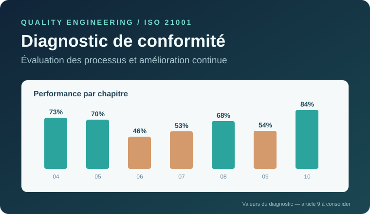

# Diagnostic de conformité ISO 21001 et amélioration continue

**Étude de cas : école d'ingénieurs · Management de la qualité · Diagnostic organisationnel**

[**Explorer l'application interactive**](https://elmokhtarrayadi21-creator.github.io/optimisation-topologique-aeronautique/projets/diagnostic-iso-21001/)



## Le projet en bref

Cette étude de cas examine l'intégration d'une démarche de management de la qualité ISO 21001 dans une école d'ingénieurs. La démarche associe **analyse des exigences**, **diagnostic par grille d'évaluation**, **examen des écarts**, **Ishikawa 5M** et **plan d'action d'amélioration continue**.

L'application met les résultats en forme pour faciliter leur lecture et leur interprétation. Elle distingue les résultats de l'évaluation, les propositions d'amélioration et les simulations.

## Diagnostic : données de référence

Le diagnostic est organisé selon les sept chapitres d'exigences 4 à 10.

| Chapitre | Domaine | Taux annoncé dans le diagnostic détaillé |
| :--- | :--- | ---: |
| 4 | Contexte de l'organisme | 73 % |
| 5 | Leadership | 70 % |
| 6 | Planification | **46 %** |
| 7 | Support | 53 % |
| 8 | Réalisation des activités éducatives | 68 % |
| 9 | Évaluation des performances | **38 %*** |
| 10 | Amélioration | 84 % |

*Le chapitre 9 apparaît aussi à **54 %** dans une figure de synthèse. L'application privilégie pour cet article la valeur du diagnostic détaillé et signale explicitement la divergence ; aucun des deux chiffres n'est certifié de manière indépendante.*

### Vérification de la grille d'évaluation

- **72 critères numérotés** de `cr1` à `cr72`, couverts par sept groupes de chapitres.
- Barème de véracité de **0 %, 30 %, 70 % et 100 %**.
- Répartition constatée en reprenant les lignes numérotées : **21 satisfaisants, 25 partiellement conformes à 70 %, 22 partiellement conformes à 30 %, 4 non conformes** — soit 72 au total.
- Le tableau récapitulatif annonce **71 évaluations**, dont **3 non conformes**. La différence ne doit pas être masquée ; les statistiques de la grille interactive reposent sur les 72 lignes effectivement numérotées.

Les résultats par chapitre sont les **taux annoncés dans l'étude**, et non une moyenne nouvelle des scores individuels. La vérification des divergences fait partie des limites identifiées.

## Analyse des non-conformités : Ishikawa 5M

Le diagramme regroupe les **15 facteurs** examinés selon cinq catégories :

| Catégorie | Facteurs principaux |
| :--- | :--- |
| **Main-d'œuvre** | Sensibilisation limitée, formation insuffisante, faible implication des acteurs |
| **Méthodes** | Procédures non formalisées, manque de KPI, suivi pédagogique insuffisant |
| **Milieu** | Communication interne, complexité organisationnelle, résistance au changement |
| **Matériel** | Équipements limités, outils numériques insuffisants, ressources techniques insuffisantes |
| **Matière** | Documentation incomplète, supports non standardisés, traçabilité insuffisante |

Le diagramme est interactif : chaque famille donne accès à une explication des facteurs et aux mesures d'amélioration associées. **Ces facteurs sont des causes potentielles à confirmer**, et non des causes ayant fait l'objet d'une démonstration causale chiffrée.

## Écarts prioritaires

Les critères détaillés permettent d'identifier des besoins concrets, par exemple :

| Critère | Constats d'évaluation | Score | Réponse proposée |
| :--- | :--- | ---: | :--- |
| `cr22` | Identification des risques | 30 % | Cartographie des risques (3 mois) |
| `cr25` | Objectifs éducatifs mesurables | 30 % | Objectifs SMART et KPI (2 mois) |
| `cr40` | Maîtrise documentaire | 30 % | Procédure documentaire (2 mois) |
| `cr62` | Programme d'audit interne | 0 % | Audits périodiques (6 mois) |

Ces durées correspondent au **plan d'action proposé** ; elles ne sont pas présentées comme des délais réellement tenus.

## Fonctionnalités interactives

1. **Tableau de bord** : lecture des principaux indicateurs et taux par chapitre.
2. **Architecture des processus** : représentation conceptuelle pilotage / réalisation / support / amélioration.
3. **Diagnostic ISO** : consultation des sept chapitres et d'une grille filtrable de **72 critères**, avec recherche, statut et export CSV.
4. **Ishikawa 5M** : véritable diagramme causes–effets avec 15 facteurs et navigation par famille.
5. **Plan d'amélioration** : 14 actions proposées, responsables, délais et KPI, avec filtres et export CSV.
6. **Simulation** : calcul théorique de la moyenne des sept taux affichés. **Ce calcul ne représente pas une mesure d'amélioration obtenue.**

## Démarche qualité

La démarche s'appuie sur la logique **PDCA (Plan–Do–Check–Act)**, sur la structuration des processus et sur l'analyse des risques et opportunités. La réflexion prend également en compte le **cadre réglementaire marocain** et la complémentarité entre ISO 9001 et ISO 21001 dans les organismes d'éducation.

## Organisation technique

```text
projets/diagnostic-iso-21001/
├── index.html          # Présentation et exploration interactive
├── style.css           # Interface responsive et tableaux de bord
├── app.js              # Navigation, Ishikawa, actions, simulation
├── audit.js            # 72 critères évalués, recherche, filtres, export
├── cover.svg           # Aperçu du projet
└── README.md           # Présentation technique
```

Application statique HTML/CSS/JavaScript, sans compte utilisateur ni stockage externe.

---

**Étude académique collective · Établissement anonymisé.** Les résultats présentés ne constituent ni un audit de certification ni la preuve d'un déploiement effectif des recommandations.

**Elmokhtar Rayadi** — Étudiant ingénieur en génie mécanique des systèmes industriels.

[**Retour au portfolio**](https://github.com/elmokhtarrayadi21-creator)